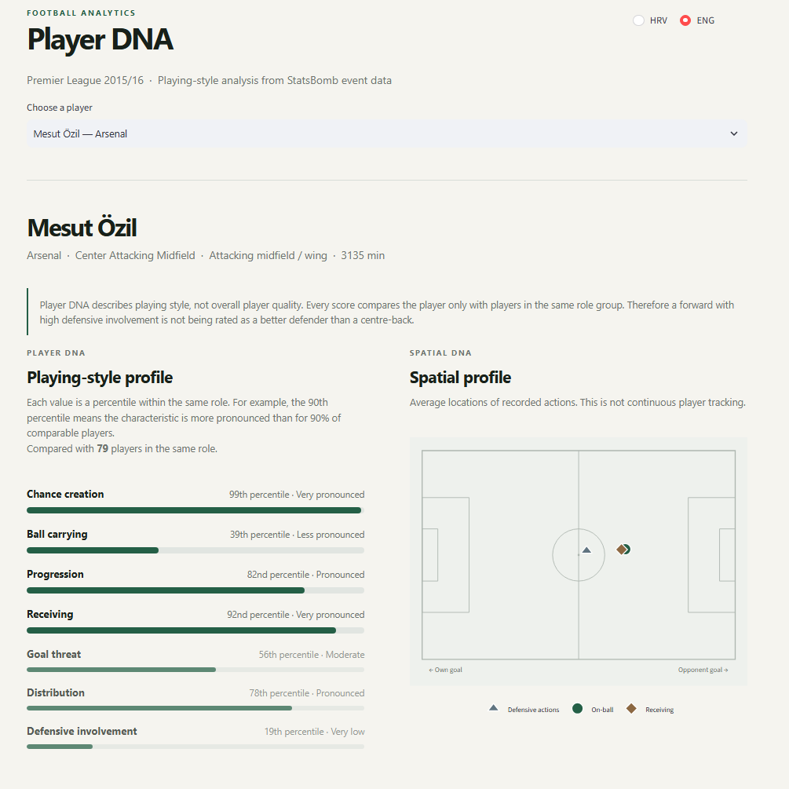

# Player DNA

### Role-aware football player style similarity from event data

Player DNA is a football analytics project that transforms event data into interpretable player style profiles and answers a simple scouting question:

> **Who plays like this player?**

The system builds season-level profiles from passing, carrying, defending, attacking, receiving and spatial actions, compares players within broad positional roles, and returns the closest playing-style matches.

It is designed to describe **how a player plays**, not how good the player is.

---

## Demo

The interactive Streamlit application allows you to:

- select a player,
- inspect their Player DNA profile,
- see role-relative percentiles,
- explore their average spatial activity,
- find the five closest style matches,
- compare two players directly,
- inspect the underlying model features.

Live demo: https://football-player-dna.streamlit.app

The current public demo uses **Premier League 2015/16 StatsBomb Open Data**.

> Suggested starting point: **Mesut Özil**.


---

## Example

For Mesut Özil, the model identifies a profile dominated by:

- elite chance creation,
- progressive passing,
- advanced receiving,
- high activity in the final third.

His closest style matches in the Premier League 2015/16 dataset include:

1. Kevin De Bruyne
2. David Silva
3. Dimitri Payet
4. Juan Mata
5. Dušan Tadić

The goal is not to claim that these players are equal in quality.

The model is identifying similarities in **playing style and event profile**.

---

## Why Player DNA?

Traditional football statistics answer questions such as:

- How many passes did a player complete?
- How many shots did they take?
- How many tackles did they make?

Player DNA tries to answer a different question:

> **Which players express a similar style across several dimensions of the game?**

A universal player vector is problematic because the meaning of football actions depends heavily on position.

For example:

- a centre-back and a forward should not be compared using the same priorities,
- high defensive activity means something different for a forward than for a centre-back,
- full-backs require different features from central midfielders,
- event volume should not automatically be interpreted as player quality.

Player DNA therefore uses **role-aware models**.

---

## Pipeline

```text
StatsBomb event data
        ↓
match-level feature engineering
        ↓
player match profiles
        ↓
season aggregation
        ↓
broad positional grouping
        ↓
feature audit and model evaluation
        ↓
role-specific Player DNA model
        ↓
standardization
        ↓
cosine similarity
        ↓
Top-5 style matches
        ↓
interactive Streamlit explanation
```

---

## Feature engineering

Player profiles are built from multiple parts of the game.

### Passing

Examples include:

- pass volume,
- completion percentage,
- average pass length,
- forward-pass percentage,
- progressive passes,
- passes into the final third,
- passes into the box,
- switches,
- crosses,
- through balls,
- passes under pressure,
- shot assists.

### Carrying and possession

Examples include:

- carry distance,
- progressive carries,
- carries into advanced areas,
- dribbles,
- successful dribbles,
- dispossessions,
- miscontrols.

### Defending

Examples include:

- pressures,
- ball recoveries,
- tackles,
- interceptions,
- blocks,
- fouls,
- defensive activity location.

### Attacking

Examples include:

- non-penalty shots,
- shots from inside the box,
- non-penalty expected goals,
- npxG per shot.

### Chance creation

Expected assists are derived by linking assisted passes with the StatsBomb xG value of the resulting shot.

### Receiving

Examples include:

- final-third receipts,
- box receipts,
- receipts under pressure.

### Spatial activity

Event locations are used to describe:

- average on-ball depth,
- average width,
- average receiving location,
- average defensive-action location,
- attacking-third activity,
- wide-area activity.

These are **event-location summaries**, not tracking-data estimates of a player's continuous physical position.

---

## Role-aware models

Player DNA v1 uses five broad outfield role groups:

| Role | Model | Features |
|---|---|---:|
| Centre-back | `ROLE_AWARE_20` | 20 |
| Full-back / wing-back | `ROLE_AWARE_30` | 30 |
| Defensive / central midfield | `FULL_51` | 51 |
| Attacking midfield / wing | `REDUCED_34` | 34 |
| Forward | `REDUCED_34` | 34 |

Goalkeepers are intentionally excluded from Player DNA v1.

They require a separate representation rather than forcing goalkeeper actions into an outfield model.

---

## Why different models by role?

Several alternative feature sets were evaluated:

- a legacy baseline,
- the full feature set,
- a reduced feature set,
- position-specific feature sets.

The same model was not automatically assumed to be best for every position.

Feature selection was guided by:

- sparsity analysis,
- feature correlation analysis,
- repeated split-stability evaluation,
- paired model comparisons,
- parsimony where two alternatives performed similarly.

This produced different selected models for different roles.

---

## Evaluation

A style-similarity model does not have an obvious ground-truth label such as:

> "Player A is objectively the correct comparison for Player B."

For that reason, Player DNA uses **self-retrieval stability** as an internal validation task.

For every eligible player:

1. their matches are randomly divided into two groups,
2. a player profile is independently built from each half,
3. one half is used as the query,
4. profiles from the other half form the candidate population,
5. the model attempts to retrieve the same player,
6. the process is repeated across multiple random splits.

A useful representation should describe a style that is stable enough for one sample of a player's matches to recognise another independent sample.

### Selected-model results

Evaluation used 50 repeated match splits.

| Role | Model | Top-1 | Top-3 | Top-5 | MRR |
|---|---|---:|---:|---:|---:|
| CB | `ROLE_AWARE_20` | 0.568 | 0.749 | 0.822 | 0.682 |
| FB | `ROLE_AWARE_30` | 0.808 | 0.945 | 0.973 | 0.880 |
| DM / CM | `FULL_51` | 0.812 | 0.943 | 0.969 | 0.882 |
| AM / W | `REDUCED_34` | 0.831 | 0.947 | 0.978 | 0.894 |
| FW | `REDUCED_34` | 0.824 | 0.955 | 0.979 | 0.892 |

These values measure **player-style stability / identity retrieval**.

They should **not** be interpreted as:

- transfer-success accuracy,
- player-quality prediction,
- probability that two players are equivalent,
- proof that a retrieved player is objectively the best comparison.

---

## Similarity

Within each role:

1. eligible player profiles are selected,
2. missing values are median-imputed,
3. model features are standardized,
4. cosine similarity is calculated,
5. the query player is excluded,
6. the five nearest players are returned.

Raw cosine similarity is deliberately not shown as a percentage in the main interface.

Instead, the UI contextualizes a match relative to the distribution of all same-role player pairs.

For example:

> **Very strong match — top 1% of role pairs**

This is easier to interpret without presenting cosine similarity as a probability.

---

## Interpreting the UI

### Player DNA

The main Player DNA dimensions are descriptive percentiles such as:

- distribution,
- progression,
- ball carrying,
- chance creation,
- goal threat,
- receiving,
- defensive involvement.

The order is adapted to the player's role.

A high percentile means that a characteristic is **more pronounced relative to comparable players**.

It does not automatically mean "better".

### Role profile

The application also highlights metrics that are particularly relevant to the selected role.

Examples:

**Centre-back**
- defensive activity,
- passing and progression.

**Central midfielder**
- midfield involvement,
- progression and creation.

**Attacking midfielder / winger**
- creation and progression,
- threat and receiving.

**Forward**
- attacking threat,
- link play and pressing.

### Spatial DNA

The pitch visualization shows average event locations for:

- on-ball actions,
- receiving actions,
- defensive actions.

These points describe event activity and should not be interpreted as tracking-derived average positions.

---

## Showcase profiles

A few useful examples for exploring the demo:

### Mesut Özil — creative attacking midfielder

Strong signals include:

- 99th-percentile chance creation,
- 99th-percentile xA,
- 100th-percentile shot assists,
- 100th-percentile passes into the box,
- 95th-percentile progressive passing.

Closest matches include Kevin De Bruyne, David Silva and Dimitri Payet.

### N'Golo Kanté — ball-winning midfielder

Strong signals include:

- 100th-percentile ball recoveries,
- 97th-percentile pressures,
- 77th-percentile progressive carries.

His profile also shows that his progression is more carry-driven than pass-volume driven.

### Riyad Mahrez — wide creator and carrier

Strong signals include:

- 99th-percentile dribbles,
- 91st-percentile xA,
- 77th-percentile progressive carries,
- high goal threat and chance creation.

### Harry Kane — all-round forward

The profile combines:

- high non-penalty xG,
- high shot volume,
- strong progression,
- involvement in link play.

### Virgil van Dijk — centre-back profile

The role-specific view separates:

- defensive involvement,
- defensive action location,
- progression,
- distribution from the back.

---

## Project structure

```text
football-player-dna/
│
├── app.py
│
├── pyproject.toml
├── README.md
│
├── data/
│   └── processed/
│
├── scripts/
│   ├── build_competition_profiles.py
│   ├── analyze_role_features.py
│   ├── evaluate_pl_role_models.py
│   ├── compare_role_model_pairs.py
│   └── ...
│
└── src/
    └── player_dna/
        ├── data/
        │   └── statsbomb.py
        │
        ├── features/
        │   ├── attacking.py
        │   ├── competition_profile.py
        │   ├── defending.py
        │   ├── minutes.py
        │   ├── passing.py
        │   ├── player_profile.py
        │   ├── positions.py
        │   ├── possession.py
        │   ├── receiving.py
        │   └── spatial.py
        │
        └── model/
            ├── player_dna_v1.py
            └── similarity.py
```

---

## Running locally

### Requirements

- Python 3.12+
- pip

Clone the repository and create a virtual environment.

### Windows / PowerShell

```powershell
python -m venv .venv
.\.venv\Scripts\Activate.ps1

pip install -e ".[dev]"

streamlit run app.py
```

The Streamlit application will then open locally in the browser.

---

## Rebuilding player profiles

Competition profiles can be generated from StatsBomb Open Data using:

```powershell
python scripts/build_competition_profiles.py `
    --competition-id 2 `
    --season-id 27 `
    --slug premier_league_2015_2016
```

The current demo uses:

```text
Competition: Premier League
Season:      2015/16
competition_id = 2
season_id      = 27
```

---

## Reproducing model evaluation

Role-model evaluation can be run with:

```powershell
python scripts/evaluate_pl_role_models.py
```

Paired comparison of competing role models:

```powershell
python scripts/compare_role_model_pairs.py
```

Feature diagnostics:

```powershell
python scripts/analyze_role_features.py
```

Evaluation outputs are stored under `data/processed/`.

---

## Data

The project is built using **StatsBomb Open Data**.

StatsBomb event coordinates use a 120 × 80 pitch representation.

The current application uses processed Premier League 2015/16 profiles derived from the open dataset.

StatsBomb should be credited when using or publishing work based on their open data.

---

## Limitations

Player DNA v1 has several deliberate limitations:

- it models **playing style, not player quality**,
- it uses event data rather than tracking data,
- spatial values represent event activity rather than continuous positioning,
- similarity is limited to players within the same broad positional role,
- the public demo currently uses one Premier League season,
- team tactics and possession context are not fully controlled for,
- some event counts depend strongly on team style,
- no age, physical, contract or injury information is included,
- goalkeeper modelling is outside the scope of v1,
- similarity should not be interpreted as transfer suitability by itself.

A real recruitment system would combine style similarity with contextual, physical, performance and squad-fit information.

---

## Next steps

Possible future extensions include:

- multi-league player search,
- cross-season player profiles,
- contextual adjustment for team possession and tactical environment,
- goalkeeper-specific Player DNA,
- richer spatial visualizations,
- learned player embeddings,
- API deployment,
- integration with video-derived tracking and computer vision data.

---

## Tech stack

- Python
- pandas
- NumPy
- scikit-learn
- Plotly
- Streamlit
- PyArrow
- StatsBomb Open Data

---

## Author

Tomislav Ivanić

Software / Computer Vision Engineer

Interests:

- football analytics,
- computer vision,
- machine learning,
- real-time vision systems,
- sports technology.

---

## Status

Player DNA v1

The outfield feature set and role-specific similarity models are frozen for the current portfolio release.

Current focus:

- product polish,
- documentation,
- testing,
- deployment.